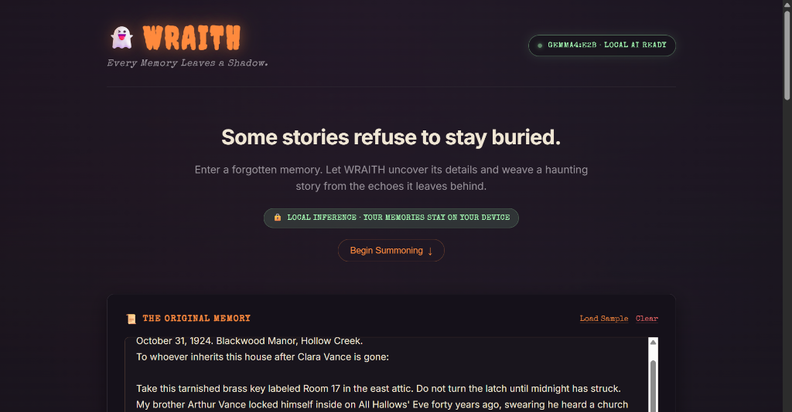

<div align="center">

# 👻 WRAITH
### *“Every Memory Leaves a Shadow.”*

**A Local-First, Privacy-Sovereign AI Memory Archive powered by Google DeepMind's Gemma 4 & Ollama.**

[](LICENSE)
[-A6FFB5.svg?style=for-the-badge&logo=google&logoColor=black)](https://ollama.com/library/gemma4)
[](https://ollama.com)
[](#-privacy-guarantees--data-sovereignty)
[](https://dev.to)
[](poster.html)

<br/>

<a href="poster.html">
  
</a>

<p align="center">
  <a href="#-quickstart--run-in-60-seconds">⚡ <b>Quickstart</b></a> •
  <a href="poster.html">📜 <b>Interactive Poster</b></a> •
  <a href="#-key-features">🔮 <b>Features</b></a> •
  <a href="#-system-architecture">🏛️ <b>Architecture</b></a> •
  <a href="#-api-reference--testing">🧪 <b>API Testing</b></a> •
  <a href="#-troubleshooting">🛠️ <b>Troubleshooting</b></a>
</p>

</div>

---

## 🕯️ The Problem WRAITH Solves

Human memories, antique correspondence, and handwritten family diaries are among our most intimate possessions. Yet modern digital preservation forces an impossible compromise:

1. **Cloud Surveillance:** Uploading personal letters or diary fragments to cloud-hosted proprietary LLMs exposes deeply private thoughts to third-party servers, training corpora, and potential data leaks.
2. **Hallucination & Loss of Ground Truth:** Most creative AI models blur historical facts with fiction until verifiable truth is irretrievably lost.
3. **Hardware Barriers:** Enterprise generative models require expensive cloud GPUs, locking developers and archivists with standard laptops (4–8 GB RAM) out of self-hosted AI.

**WRAITH resolves this dilemma**:
- **100% Local Inference:** Powered by Google DeepMind's **Gemma 4 Edge (E2B)** through **Ollama**.
- **Dual-Layer Analysis:** Objectively separates verified historical facts from imaginative supernatural fiction.
- **Consumer Hardware Friendly:** Runs smoothly on everyday CPUs or integrated GPUs without cloud subscriptions or API keys.

---

## ⚡ Quickstart — Run in 60 Seconds

### Prerequisites
- **Node.js** (v18.0.0 or higher recommended)
- **Ollama** installed on your system ([Download Ollama](https://ollama.com/download))

```bash
# 1. Pull the Gemma 4 Edge model (3.5 GB - runs in 4-8 GB RAM)
ollama pull gemma4:e2b

# 2. Clone the repository and install all dependencies
git clone https://github.com/your-username/wraith.git
cd wraith
npm run install:all

# 3. Launch both the backend server and frontend client concurrently
npm run dev
```

> [!TIP]
> Open your browser to **`http://localhost:3000`** to enter the archive, or double-click **`poster.html`** to explore the standalone interactive presentation cover!

---

## 🔮 Key Features

### 1. 🛡️ 100% Air-Gapped Local Inference
- Connects directly to your local loopback Ollama instance (`http://127.0.0.1:11434`).
- **Zero Cloud Footprint:** No external network requests, zero telemetry, no API billing meters. Disconnect your Wi-Fi—WRAITH continues to function completely offline.

### 2. ⚖️ Dual-Layer Grounding (Fact vs. Folklore)
- **Verified Archive Ledger:** Strictly extracts names of historical figures, dates, cataloged artifacts, and explicit occurrences directly from the source text. Zero hallucination policy.
- **The Haunted Chronicle:** Weaves the atmosphere and emotional weight into an eerie, literary ghost story presented in an aged manuscript parchment card.

### 3. 📜 The Forgotten Vault (Zero Database Overhead)
- Automatically persists summoned stories to browser `localStorage` (`wraith_archive_v1`).
- **One-Click Markdown Export (`.md`):** Export any entry formatted with YAML frontmatter ready for Obsidian, Logseq, or local markdown vaults.

### 4. 🎨 Atmospheric Victorian Gothic Aesthetics
- Candlelight orange (`#FF8A3D`), ghostly ectoplasm green (`#A6FFB5`), and deep charcoal void (`#0D0D0F`).
- Drifting ambient mist, procedural candle flicker, and typography featuring **Creepster** and **Special Elite**.
- Respects system accessibility (`prefers-reduced-motion`).

### 5. 📜 Standalone Interactive Cover Poster
- Includes a dedicated [poster.html](poster.html) with:
  - Procedural **Web Audio API** soundscape (haunted wind drone & candle crackle).
  - Interactive **Ghost Lantern (Flashlight Lens)** that reveals hidden runes and system specs.
  - Live **Interactive Séance Simulator** with instant typewriter decoding.
  - High-res **Print / Save PDF** presentation mode.

---

## 🏛️ System Architecture

```
┌───────────────────────────────────────────────────────────┐
│                     Browser Client                        │
│   React 18 + Vite · Responsive Haunted UI · LocalStorage  │
└─────────────────────────────┬─────────────────────────────┘
                              │
                    HTTP JSON REST (Proxy)
                              │
┌─────────────────────────────v─────────────────────────────┐
│                   Node.js Express Server                  │
│    GET  /api/health   ──> Verifies Ollama & Gemma 4 Tag   │
│    POST /api/analyze  ──> Schema Validation & Sanitizer   │
└─────────────────────────────┬─────────────────────────────┘
                              │
                    Local Loopback Network
                              │
┌─────────────────────────────v─────────────────────────────┐
│                      Ollama AI Runtime                    │
│             http://127.0.0.1:11434 (JSON Mode)            │
└─────────────────────────────┬─────────────────────────────┘
                              │
                    Direct Model Execution
                              │
┌─────────────────────────────v─────────────────────────────┐
│               Google DeepMind Gemma 4 Edge                │
│    Model: gemma4:e2b (Effective 2B) · 4-8 GB RAM Footprint│
└───────────────────────────────────────────────────────────┘
```

### Technology Matrix

| Layer | Technology | Purpose |
| :--- | :--- | :--- |
| **Frontend** | React 18, Vite | Instant HMR, declarative state management, low bundle footprint |
| **Styling** | Custom Gothic CSS | Drifting mist animations, ember glow, accessible contrast |
| **Typography** | Creepster, Special Elite, Inter | Victorian archival stamp aesthetics with system fallbacks |
| **Backend API** | Node.js (v18+), Express | Prompt structuring, input sanitization, Ollama proxy |
| **AI Runtime** | Ollama | Local model daemon & structured JSON streaming |
| **AI Model** | Google DeepMind **Gemma 4** (`gemma4:e2b`) | Verified local open-weight instruction model |
| **Persistence** | Web Storage API (`localStorage`) | Sovereign local archive without database management |
| **Cover Poster** | HTML5, Canvas, Web Audio API | Standalone interactive exhibition cover page |

---

## 🧠 Gemma 4 Model Specs & Verification

WRAITH is designed around the official **Gemma 4** model family:

- **Model Identifier:** `gemma4:e2b`
- **Architecture:** Effective 2 Billion Parameters (quantized for on-device edge execution)
- **Context Window:** Up to 128,000 tokens
- **Disk Storage:** ~3.5 GB
- **RAM Requirement:** ~3.8 GB to 5.2 GB (runs smoothly on typical 4–8 GB consumer hardware)
- **Model Verification Command:**
  ```bash
  ollama show gemma4:e2b
  ```

> [!NOTE]
> If your system has 16GB+ RAM and a dedicated GPU, you can switch to `gemma4:e4b` or `gemma4:12b` by updating `GEMMA_MODEL` in your `server/.env` file.

---

## ⚙️ Configuration & Environment

Configuration is stored in `server/.env`. A starter template is provided in `.env.example`:

```bash
cp .env.example server/.env
```

| Environment Variable | Default Value | Description |
| :--- | :--- | :--- |
| `PORT` | `5001` | Express backend listening port |
| `OLLAMA_HOST` | `http://127.0.0.1:11434` | URL of your local Ollama instance |
| `GEMMA_MODEL` | `gemma4:e2b` | Ollama model tag for inference |

### Vercel deployment

The client can be deployed to Vercel, but Vercel cannot reach an Ollama process running
on your computer at `127.0.0.1:11434`. Host the Express server and Ollama-compatible
inference service on a reachable server first, then configure the Vercel project as
follows:

1. Import `PruthviRajG25/Hacktoberfest-Week4` in Vercel.
2. Set the project **Root Directory** to `client`.
3. Set the **Build Command** to `npm run build` and the **Output Directory** to `dist`.
4. Add the client environment variable `VITE_API_BASE_URL` with the public URL of the
   hosted Express backend, without a trailing slash.
5. Deploy and verify that `/api/health` on the backend reports the expected Ollama
   connection.

When `VITE_API_BASE_URL` is unset, local development continues to use the Vite proxy
at `http://127.0.0.1:5001`.

---

## 🧪 API Reference & Testing

### 1. Health Verification (`GET /api/health`)

Verify model availability and Ollama connection status:

```bash
curl http://localhost:5001/api/health
```

**Expected Response (`200 OK`):**
```json
{
  "status": "ready",
  "message": "Ollama is active and model 'gemma4:e2b' is ready for local inference.",
  "model": "gemma4:e2b",
  "ollamaConnected": true,
  "modelInstalled": true,
  "availableModels": ["gemma4:e2b"]
}
```

### 2. Memory Extraction & Story Generation (`POST /api/analyze`)

Submit a historical text fragment for dual-layer analysis:

```bash
curl -X POST http://localhost:5001/api/analyze \
  -H "Content-Type: application/json" \
  -d '{"memory": "October 31, 1924. Blackwood Manor. Arthur Vance locked himself in Room 17."}'
```

**Expected Response (`200 OK`):**
```json
{
  "title": "The Sealed Threshold of Room 17",
  "summary": "An archival account of Arthur Vance sealing himself inside the east attic of Blackwood Manor.",
  "people": ["Arthur Vance"],
  "dates": ["October 31, 1924"],
  "locations": ["Blackwood Manor", "Room 17"],
  "artifacts": ["Brass key"],
  "tale": "Beneath the floorboards of Room 17, forty years of silence curl like dried autumn leaves..."
}
```

---

## 🪟 Interactive Poster & Cover Exhibition

WRAITH includes an interactive exhibition poster suitable for project submissions, hackathons, and developer presentations:

```
hw4/
├── assets/
│   ├── wraith-cover.png         # High-res UI cover screenshot
│   └── wraith-original.png      # Raw application capture
├── poster.html                  # Standalone interactive poster
├── client/
│   ├── public/poster.html       # Vite-served poster (/poster.html)
│   └── src/App.jsx              # Includes in-app "📜 Interactive Poster" modal
```

To experience the cover poster:
- **Standalone:** Double-click [`poster.html`](poster.html) in any browser.
- **From App:** Click the **`📜 Interactive Poster`** button in the hero section of the running web application.

---

## 🛠️ Troubleshooting

<details>
<summary><b>1. Status badge displays "CONNECTING TO LOCAL MODEL" or "MODEL UNAVAILABLE"</b></summary>
<br/>

- Verify that Ollama is currently running:
  ```bash
  ollama list
  ```
- If Ollama is not active, start it from your terminal or application launcher:
  ```bash
  ollama serve
  ```
- Ensure the model has finished downloading:
  ```bash
  ollama pull gemma4:e2b
  ```
</details>

<details>
<summary><b>2. Port 5001 or 3000 is already in use</b></summary>
<br/>

- Change the backend port in `server/.env`:
  ```env
  PORT=5002
  ```
- Update `client/vite.config.js` proxy settings if you change the backend port.
</details>

<details>
<summary><b>3. Client fails to connect to backend during development</b></summary>
<br/>

- Vite proxies requests from `http://localhost:3000/api/*` to `http://localhost:5001/api/*`.
- Verify both processes are running via `npm run dev` or run them in separate terminal windows:
  - Terminal 1: `npm --prefix server run dev`
  - Terminal 2: `npm --prefix client run dev`
</details>

---

## 🛡️ Privacy Guarantees & Honest Limitations

- ✅ **Zero Telemetry:** No analytics scripts, tracker cookies, or remote pings.
- ✅ **Offline Operational:** Once Gemma 4 is downloaded, WRAITH runs with zero internet connection.
- ⚠️ **LocalStorage Storage:** Memories saved to the Forgotten Archive reside in browser `localStorage`. They are unencrypted and visible to anyone sharing your local browser profile.
- ⚠️ **Creative Fiction Notice:** Extracted archive records are grounded in the user's text, but ghost stories are imaginative fiction.

---

## ⚖️ License & Attribution

- **Application Code:** [MIT License](LICENSE)
- **Model Weights:** Google DeepMind Gemma 4 provided under the [Gemma Terms of Use](https://ai.google.dev/gemma/terms).
- **Challenge:** Built for the **Ghost in the Machine** Open Source AI Challenge.

<br/>

<div align="center">
  <sub>“Memories may fade into silence, but in the machine, their shadows endure.” 👻🕯️</sub>
</div>
